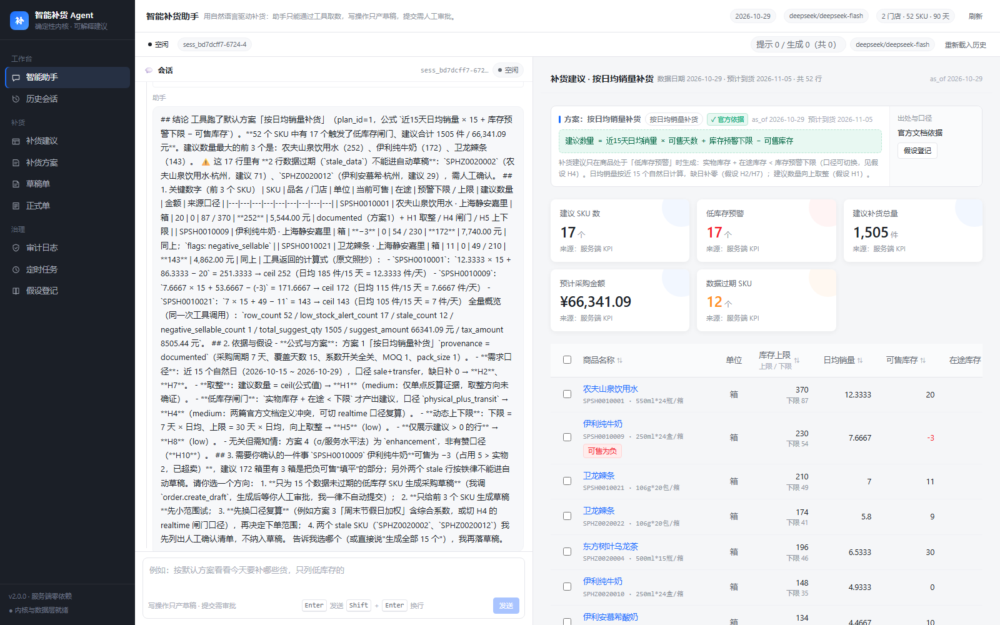
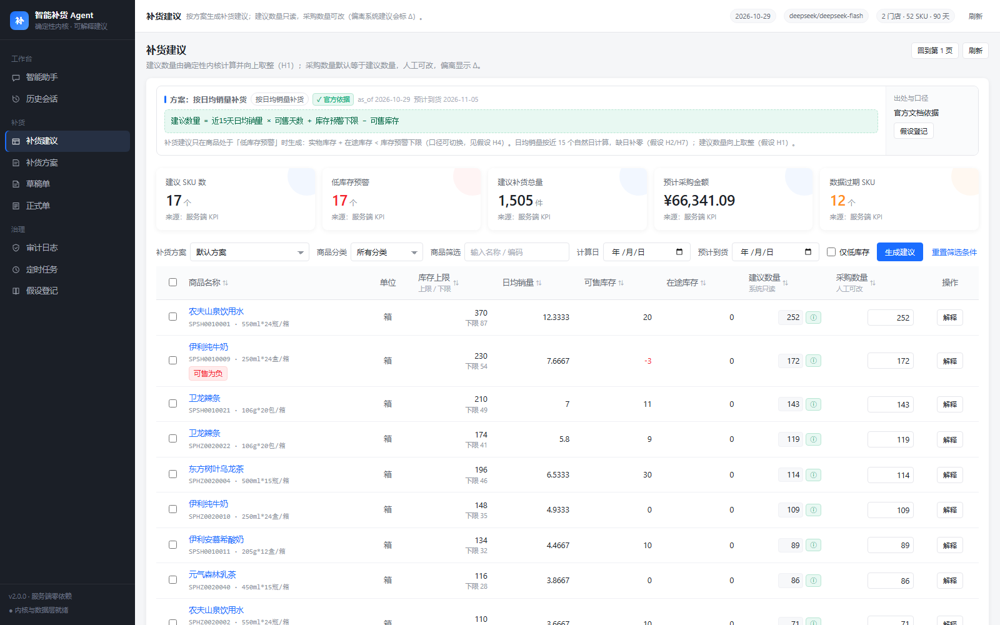
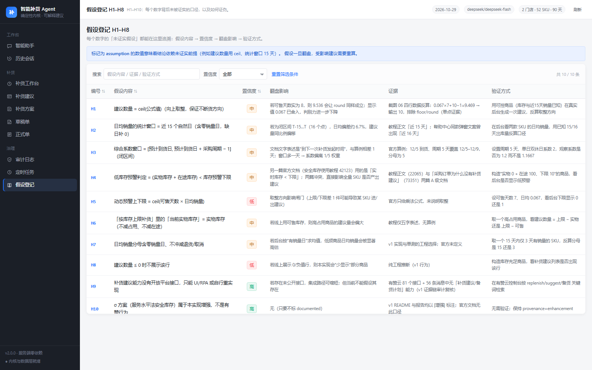
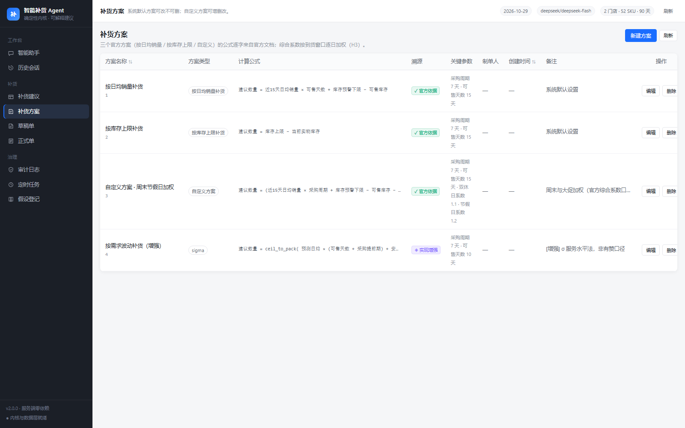
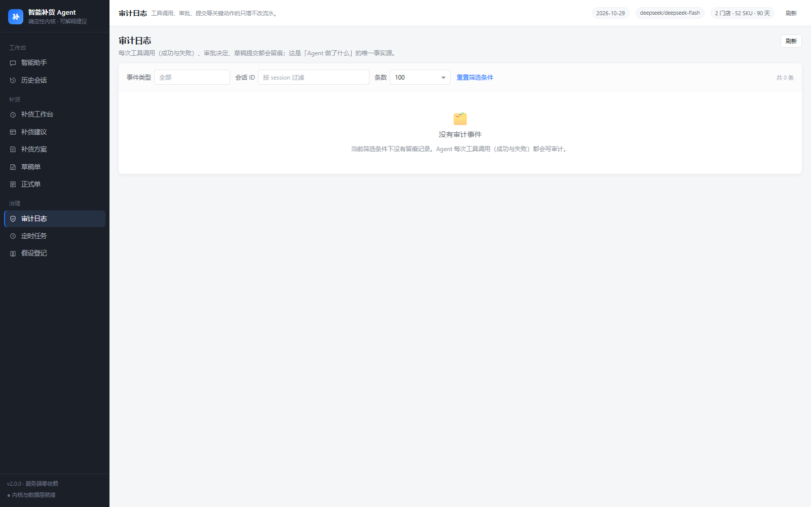
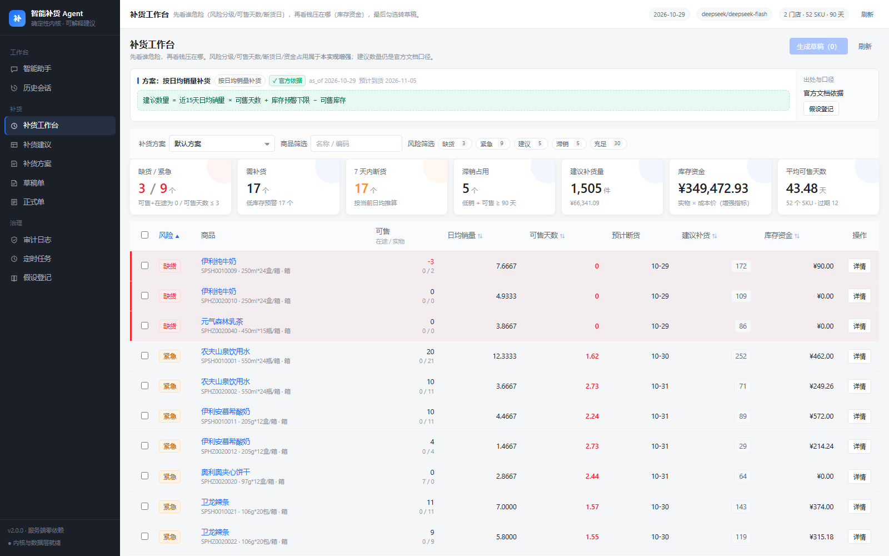
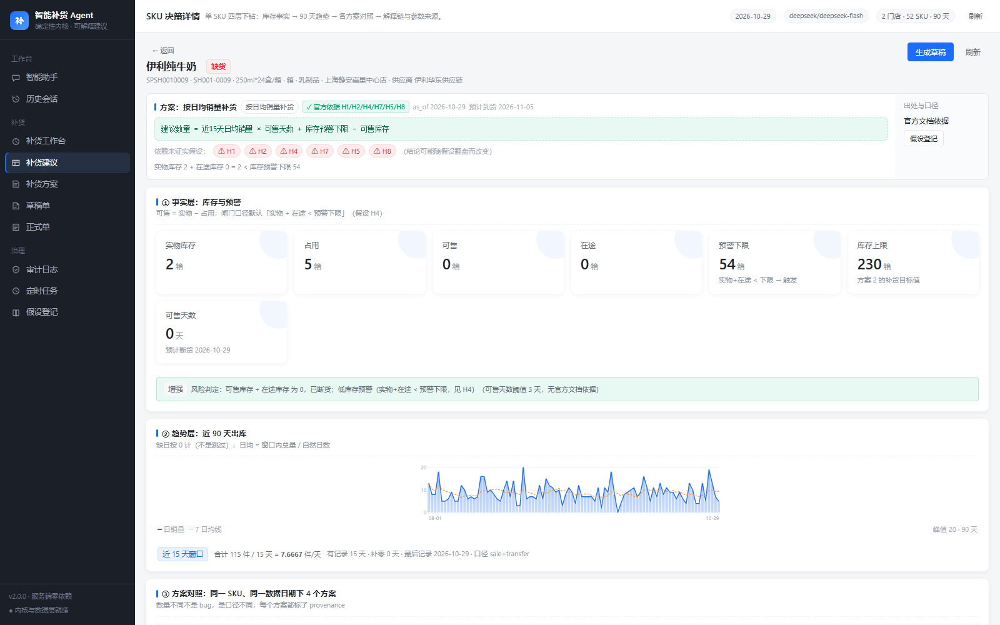

# 智能补货 Agent（v2）

> 一个**能算、能解释、能被审**的补货 Agent：确定性内核负责算，大模型负责问与说，人负责签字。
> 事实来源：有赞商家后台「补货建议」的公开文档与真实界面（v1 逆向分析），但**本项目的实现与有赞无隶属关系**，
> 也没有取得其登录态代码或私有接口。口径、假设与证据等级见 `docs/02-provenance.md` 与 `docs/03-assumptions.md`。

---

## 1. 它是什么

**一个运行时 + 两个入口**：

| 入口 | 触发 | 产出 |
|---|---|---|
| **Copilot**（`#/agent`） | 人在对话里提问 | 工具调用时间线 → 建议产物（artifact）→ 草稿单 → 审批卡 |
| **Auto**（`#/schedules`） | 定时/事件触发 | 待审补货清单 + 审计事件 |

三条硬规则（runtime 层强制，不靠提示词）：

1. **LLM 不许自算数字**：所有数值只能来自确定性工具（`server/domain` 纯函数）；
2. **写操作只产草稿**：提交正式单必须携带人工审批 `approval_id`，无审批直接拒绝；
3. **每个数字都能自证**：`provenance`（documented / enhancement / assumption）+ `assumptions`（H1–H10）+ `terms` + `why` 解释链。

---

## 2. 快速开始

要求：**Node.js ≥ 22.5**（使用内置 `node:sqlite`，无需编译原生模块）。实测 Node v24.16 / Windows。

```bash
cd replenishment-agent

npm install            # 前端构建依赖（服务端零第三方依赖）
cp .env.example .env   # 填入 LLM_API_KEY；不填则自动降级为 mock provider（可离线跑通全流程）
npm run build          # 构建前端到 dist/
npm start              # 起服务：API + 静态站点同端口
# → http://127.0.0.1:3200
```

首次启动自动建库并播种：2 门店 / 52 SKU / 90 天销量（刻意植入**缺日 / 过期快照 / 超卖**三类脏数据）。

| 命令 | 作用 |
|---|---|
| `npm start` | 启动服务（`PORT`、`HOST`、`DB_PATH` 可覆盖） |
| `npm run dev:web` | 前端开发服务器（5273，代理 `/api` → 3200） |
| `npm run build` | Vite 构建前端到 `dist/` |
| `npm run typecheck` | `tsc --noEmit`（strict） |
| `npm test` | 域 / 数据 / Agent / API 四组测试 |
| `npm run verify` | 端到端验收（真实起服务打 HTTP/SSE；`--live` 额外跑一轮真实模型对话） |
| `npm run seed` | 重建演示数据（先停服务） |

---

## 3. 架构

```
┌──────────────────────────── 浏览器（React 18 + Vite + TS） ────────────────────────────┐
│  #/agent 左会话（消息 / 思考 / 工具时间线 / 审批卡） │ 右产物（建议表 / 草稿 / 解释面板）    │
│  #/suggestions  #/plans  #/orders  #/audit  #/schedules  #/assumptions                 │
└───────────────────────────────────┬────────────────────────────────────────────────────┘
                                    │ HTTP + SSE（data: {seq,type,...}）
┌───────────────────────────────────▼────────────────────────────────────────────────────┐
│ server/http  （零框架） router · sse · validate · respond · static                      │
├────────────────────────────────────────────────────────────────────────────────────────┤
│ server/agent   runtime（多步工具循环/预算/事件流/审批闸门） · tools×14 · scheduler        │
│                providers  deepseek（OpenAI 兼容，流式 + tool calls + reasoning）| mock   │
├────────────────────────────────────────────────────────────────────────────────────────┤
│ server/data    repository（SQLite 仓储）· queries（读模型：建议/KPI/详情）· seed          │
├────────────────────────────────────────────────────────────────────────────────────────┤
│ server/domain  纯函数确定性内核（无 IO / 无系统时钟 / 全量单测）                            │
│   dates · math · plans · demand · inventory · safety · calendar · suggestion · assumptions│
└────────────────────────────────────────────────────────────────────────────────────────┘
```

**为什么内核必须是纯函数**：Agent 会重试、会并行、会被 replay；只有一个无状态、可注入 `asOf`、
可单测的内核，才能保证「同一输入永远同一建议」，也才能让 LLM 的输出可审计。

---

## 4. 可信三件套（本项目的核心设计）

1. **双列护栏**：`建议数量` 只读、`采购数量` 可编辑，偏离时显示 Δ —— 系统给建议，人做决定（该范式取自
   有赞后台真实界面：截图 06 可见）。
2. **Citation strip**：公式横幅三态（`documented` / `enhancement` / 依赖 `assumption`），
   每个数字旁的可点徽标能回到「用了哪条口径、依赖哪条假设、假设怎么证伪」。
3. **解释链**：每条建议自带 `terms`（逐项数值）、`guard`（闸门判定原文）、`coefficient_detail`（逐日系数与原因）、
   `why`（窗口→库存→预警→闸门→公式的分步推导），前端画成逐日系数条形图。

---

## 5. 目录

```
server/
  domain/            纯函数内核（唯一算法出口）
  data/              db.mjs（建表/播种）· repository.mjs · queries.mjs · seed.mjs
  agent/             runtime.mjs · scheduler.mjs · approval.mjs · tools/ · prompts/
  providers/         deepseek.mjs · mock.mjs · index.mjs
  http/              router.mjs · sse.mjs · validate.mjs · respond.mjs · static.mjs
  config.mjs         .env 解析 + 安全投影（绝不输出 key）
  index.mjs          createServer（可注入/可测试）+ CLI
web/src/
  app/               外壳 · 路由 · 类型
  lib/               api · sse · format · hooks
  styles/            tokens · base · components · features
  components/        Kpi · Citation · ProvenanceTag · DataTable · Sparkline · Drawer · Modal · Toast …
  features/          agent · suggestion · plan · order · audit · schedule · assumption
docs/
  00-migration.md    v1→v2 取/改/弃台账（含回归用例清单）
  01-architecture.md 架构与决策记录
  02-provenance.md   证据分级与 provenance 规范
  03-assumptions.md  H1–H10 假设登记表
  04-runbook.md      运行/排障/验收手册
```

---

## 6. 与 v1 的关系

v1（`E:\REA_SHISHI`）是一份「有赞补货建议」的逆向分析与可运行复刻。本项目**不 fork 它、不复用它任何结论**，
只做了三件事：抽走文档口径的算法规格、抽走「建议→确认」的界面范式、抽走证据分级纪律；
同时修掉了它的 3 个算法级真 bug（缺日窗口、取整多算 1 件、<1 系数被吞）与 4 个高风险缺陷，
并把「补货建议」升级为「Agent + 审批 + 审计」的形态。逐条取舍见 [`docs/00-migration.md`](docs/00-migration.md)。

---

## 7. 已知边界（诚实清单）

1. **未观测有赞真实接口/取整/参数**：`ceil`、15 天窗口、闸门口径、可售天数来源等仍是假设（H1–H8），
   验证方法写在 `docs/03-assumptions.md` 每条的 `probe`。
2. **有赞没有补货建议的开放接口**（H9）：本项目不承诺"对接有赞"，集成只能 RPA 或自建数据管道。
3. **单仓视角**：多仓调拨、配销加价、退货冲销未建模（H7）。
4. **模型不确定性**：靠三层防线（工具唯一取数 / 数字必须引用工具结果 / 提交需人工审批）约束；
   上线前建议再加一层「输出数字与工具结果对账」的校验器。
5. **演示数据是合成的**（固定随机种子，可复现），不是真实经营数据。

---

## 8. 界面速览（headless Chrome 实拍，脚本自动断言后再截图）

| 页面 | 截图 |
|---|---|
| 智能助手（真实模型跑完一轮：左会话 / 右产物） |  |
| 补货建议（9 列 + 只读建议/可改采购 + Δ + 出处） |  |
| 假设登记 H1–H10（每个数字背后未被证实的口径） |  |
| 补货方案（系统默认可改不可删） |  |
| 审计日志（工具调用/审批/提交只增不改） |  |

> 复现：`node scripts/shots.mjs`（会启动 headless Chrome、断言关键元素渲染后再截图）。

---

## 9. 验收结果（本机实测）

```text
npm test                    144 pass / 0 fail      （domain 42 · data 13 · agent 36 · api 41 · config 6 + 根级 6）
node scripts/verify.mjs      54 PASS / 0 FAIL       （进程内起服务 + 临时库，含决策支持组）
node scripts/verify.mjs --live  57 PASS / 0 FAIL    （额外真实模型：tool_call / done / usage）
npm run typecheck             exit 0                （tsc --noEmit, strict）
npm run build                 ✓ 68 modules → 258KB JS + 53KB CSS
node scripts/live-e2e.mjs     一轮真实会话：4 次工具调用 → 建议产物 → 17 行建议，审计 10 条
```

真实模型链路（`deepseek-flash`）实测示例：一次提问触达
`catalog.list_skus → plan.list → assumption.list → suggestion.compute`，
产出 `artifact=suggestions`（17 行低库存、合计 1,505 件 / ¥66,341.09），
会话落库 8 条消息（user/assistant/tool…），审计留痕 `tool_call`×4 + 轮次开始/结束。

---

## 10. 决策支持（v2.1 补回 v1 的驾驶舱）

v2 第一版把 v1 的「补货工作台 + SKU 四层下钻」当成"非文档口径"砍掉，属于判断失误：砍掉的不只是增强指标，
还有辅助决策这个职责。现已补回，并明确标注可信边界（数量=documented，风险=enhancement）：

| 能力 | 位置 | 说明 |
|---|---|---|
| 补货工作台 | `#/workbench` | 风险分级（缺货/紧急/建议/滞销/充足）+ 可售天数 + 预计断货日 + 库存资金 + 7 天内断货数；勾选 → 批量转草稿 |
| SKU 决策详情 | `#/sku/:code` | ① 库存事实 ② 90 天曲线 ③ 4 方案对照 ④ 解释链（terms/逐日系数/why）+ 参数来源 |
| 行级解释抽屉 | 建议表「解释」 | terms / 逐日综合系数 / 闸门 / 分步推导 |





接口：`GET /api/workbench`（风险视图 + KPI + 页面级可信声明）、`GET /api/sku/:code`（含 `decision` 与 4 方案对照）。
风险规则见 `server/domain/risk.mjs`（纯函数，10 项单测），阈值可配、必须显式标注为非官方口径。
